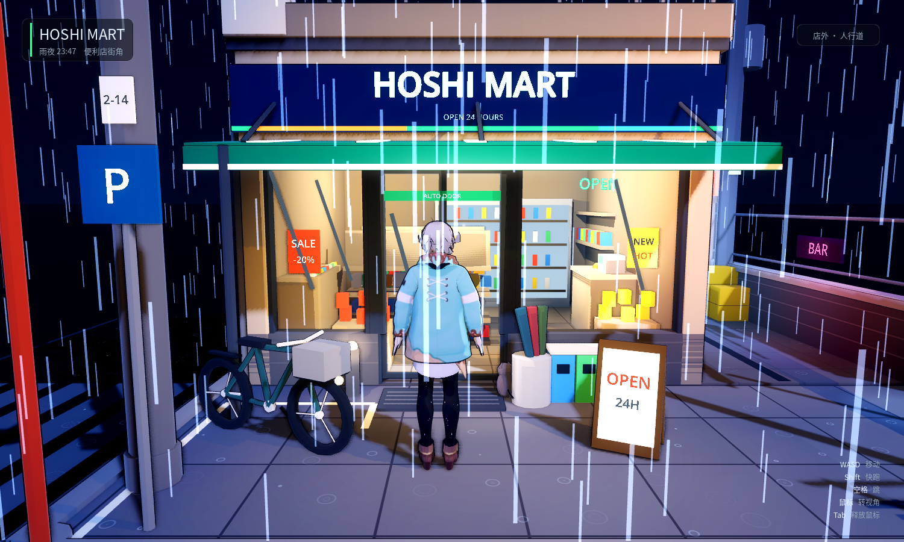

# 雨夜便利店街角 / Rainy Corner Mart

一个用 Godot 4.7 程序化搭建的「雨夜日式便利店街角」微缩场景。全部几何体、材质、灯光与雨效均由 GDScript 在运行时生成，没有外部模型或贴图依赖。

场景有两种看法：

| 版本 | 场景 | 玩法 |
| --- | --- | --- |
| **可玩版**（当前入口） | `scenes/store_walk.tscn` | 第三人称走进便利店：自动门、店内交互、跟随镜头；进过店再下马路会被货车撞 |
| 微缩展示版 | `scenes/main.tscn` | 轨道相机俯瞰整个 11.2m 底座，原版编排 |
| 编排备份 | `scenes/diorama_orbit.tscn` | 改造前编排的冻结副本（见「备份」一节） |



## 运行

```bash
# 用 Godot 4.7.2 打开本目录（选中 project.godot），按 F5
# 或直接命令行启动：
./Godot_v4.7.2-stable_linux.x86_64 --path .
```

F5 默认进入 `scenes/store_walk.tscn`：先是一段从微缩全景推近到人物背后的镜头，
落到人行道后就能操作。单独看某个场景用 `--path . res://scenes/xxx.tscn`。

原来的开场流程（雨夜三幕动画 → 异世界草原）仍在，只是不再是默认入口：

```bash
./Godot_v4.7.2-stable_linux.x86_64 --path . res://scenes/opening_flow.tscn
```

渲染器为 **Forward+**（湿地面 SSR 反射、SSAO、体积雾、景深需要 Forward+）。
若机器只有 OpenGL，场景仍可正常显示，只是会失去屏幕空间反射与体积雾。

> 换了机器或拉了大文件之后，先跑一次 `--headless --editor --quit` 重新导入资源。
> `.godot/` 不进仓库，缺了这一步音频和 `gaia.glb` 会加载失败，场景看起来就像「少了东西」。

## 操作（可玩版）

| 操作 | 效果 |
| --- | --- |
| `W A S D` / 方向键 | 移动（相对镜头方向） |
| `Shift` | 快跑 |
| `空格` | 跳 |
| 鼠标移动 | 转视角（第三人称弹簧臂） |
| 鼠标滚轮 | —— 预留，当前固定机位距离 |
| `E` / `F` | 与冷柜 / 货架 / 服务铃 / 猫互动 |
| `Esc` | 释放鼠标（点回窗口重新锁定） |

**自动门**不需要按键：走到门前 2.35m 自动滑开，离开 0.45 秒后自动关闭；
人卡在门洞里时不会关。门楣上的感应灯关着是红的、开了是绿的。

进店之后镜头会自动换成短焦段（1.6m / FOV 70° / 右肩偏移），
曝光从 1.12 收到 0.92 —— 否则店内三盏暖光正对着天花板，会直接烧白。

**车祸事件**：先进店，再走出门、下到马路上（南侧车行道），右侧会驶来一辆
大货车。这是一次性的演出，撞完人会回到出生点，之后在马路上走就安全了。

## 备份：改造前的编排

改造前先做了两层备份，任何一层都能回到原样：

1. **标签** `backup/orbit-diorama` —— 指向改造前的提交（可 `git checkout` 完整还原）。
2. **可运行副本** `scenes/diorama_orbit.tscn` + `scripts/backup/diorama_orbit.gd`
   —— `main.gd` 当时的逐字副本，随时随地能跑一遍旧版做对照，不需要切分支。

```bash
./Godot_v4.7.2-stable_linux.x86_64 --path . res://scenes/diorama_orbit.tscn
```

注意副本引用的是「当前」的 `street.gd / store.gd / props.gd`，冻结的是编排
（机位、灯光、开场、角色站位），不是整棵依赖树。

## 场景构成

```
scenes/store_walk.tscn  可玩版入口（第三人称 + 交互）
scenes/main.tscn        微缩展示版（只挂 main.gd）
scenes/diorama_orbit.tscn 编排备份（冻结副本）
scenes/opening_flow.tscn  原开场流程（雨夜三幕 → 草原）
scenes/grassland.tscn   异世界草原

scripts/store_walk.gd   可玩版编排：装配世界 / 玩家 / 门 / HUD / 交互 / 开场推镜 / 截图模式
scripts/truck.gd        大货车造型（6.2m 厢式，材质带台面裁剪）
scripts/truck_event.gd  车祸事件：触发条件 / 冲刺 / 命中 / 收黑 / 复位
scripts/world_env.gd    环境、月光、雨、涟漪（从 main.gd 抽出，参数逐项照搬）
scripts/collision_layout.gd 简化碰撞层：地面 / 墙 / 货架 / 台阶斜面 / 街道设施 / 边界
scripts/autodoor.gd     自动门：两片带碰撞的滑动门叶 + 感应 + 叮咚音
scripts/interaction_hub.gd 交互中枢：最近目标出提示，按 E 触发
scripts/hud.gd          HUD：标题 / 区域 / 交互提示 / 物件反馈 / 操作说明
scripts/sfx.gd          程序化音效（门铃 ping-pon、服务铃、轻触）
scripts/player_controller.gd 第三人称控制器（移动 / 跳跃 / 弹簧臂 / 相机档位）
scripts/actor.gd        VRoid 主角模型加载、掰姿势、平色材质、描边
scripts/store.gd        便利店：外壳 / 玻璃立面 / 自动门位 / 雨棚 / 招牌 / 屋顶 / 店内
scripts/street.gd       底座 / 人行道 / 马路 / 标线 / 电线杆 / 路灯 / 街角设施 / 湿地面光池
scripts/props.gd        道具：贩卖机 / 自行车 / 伞架 / 垃圾桶 / 后巷 / 猫
scripts/kit.gd          建模工具库：体块、圆柱、管线、拉杆、文字、材质缓存
scripts/backup/diorama_orbit.gd 改造前编排的冻结副本
scripts/dialogue/       对话解析与播放（草原用）
shaders/                三渲二 / 描边 / 砖缝 / 玻璃 / 自发光 / 湿光 / 雨 / 涟漪
tools/walk_probe.tscn   自动行走回归测试（见「自测」）
tools/truck_probe.tscn  车祸事件回归测试（见「自测」）
```

## 交互实现要点

- **能走进去，而不是「看着能进去」**：原场景的踢脚墙横跨整个立面（含门洞），
  店内三排货架间距只有 0.53m。`Store.build(root, {"walkable": true, ...})` 会把
  踢脚墙按门洞断开，货架改成两块、留出 ≥0.83m 过道，收银台挪到东墙。
  `Store.layout(walkable)` 是视觉与碰撞的唯一真源，改一处两边一起动。
- **门是真的门**：门叶是 `AnimatableBody3D`，玻璃 / 门框 / 把手都是它的子节点，
  开合补间挪的是物理体本身，所以「门开了」和「人能过」是同一件事。
- **看不见的坡**：路缘 16cm、店门槛 9cm，人物没有自动上台阶逻辑。这两处用
  `ConvexPolygonShape3D` 楔形补了隐形斜面 —— 比给控制器加 step-up 安全，
  不会顺带改变草原场景的手感。路缘石的顶面和人行道齐平（0.16），
  隐形坡整条铺在路缘石外侧（`x < −2.07` / `z > 2.07`）：石头是实心的可见几何，
  碰撞足迹不跟上的话，人站在路边脚会埋进石头里。
- **接触阴影**：夜景主光只有 0.55 能量，脚底几乎没有影子。脚下挂一张
  Alpha 径向渐变面片，每帧向下打一条射线贴地，跳起来时缩小变淡。
- **声音**：门铃 / 服务铃是运行时合成的 PCM（`sfx.gd`），雨声与店内低频复用现成 wav。
  进店时雨声压到 −26dB、低频抬到 −24dB，玻璃把雨关在了外面。
- **车祸事件**：进过店（区域判定 `"in"`）之后走到南侧车行道中间（`z > 3.7`）触发，
  锁输入 → 0.42s 预警喇叭 → 货车从台面外 9m 处以 13m/s 冲进来。
  车头距人 4.5m 时 `Engine.time_scale` 收到 0.35（慢镜头），命中后击飞 + 白闪 +
  镜头抖 + 闷响，0.22s 收黑，黑场里复位到出生点。详见 `docs/任务03-马路车祸事件.md`。
- **超出台面的部分不渲染**：`toon / outline / glow` 三个 shader 都加了
  `clip_on / clip_min / clip_max`，片元世界坐标越界就 `discard`。
  货车一律用 `kit.toon_clipped()` / `glow_clipped()` 生成材质 ——
  `kit.toon()` 是按参数缓存的，裁剪参数写进缓存会顺带把整条街裁掉。
  裁剪盒就是 `kit.PLATFORM_CLIP`（x/z ±5.6），切口和底座边缘严丝合缝。

## 自测

```bash
# 无渲染，只跑物理：走进店门 → 东侧过道 → 冷柜 → 退出门 → 爬回路缘
./Godot_v4.7.2-stable_linux.x86_64 --headless --path . res://tools/walk_probe.tscn
```

输出 9 条断言（门是否打开、是否跨过门槛、是否踩上 0.25m 店内地板、
能否走到冷柜前、提示文案是否正确、离开后门是否关上、能否爬上 16cm 路缘）。
退出码非 0 表示有断言失败，改完几何以后跑一遍就知道有没有把路堵死。

```bash
# 无渲染，只跑事件状态机：没进店不触发 → 进店 → 路缘不触发 → 路中间 → 命中 → 复位 → 车回收
./Godot_v4.7.2-stable_linux.x86_64 --headless --path . res://tools/truck_probe.tscn
```

15 条断言：触发前置条件、路缘 / 路中间的触发线、生成点在台面外、材质带裁剪参数、命中与击飞、
复位位置与输入锁、车出台面后回收、事件不重复触发。

## 美术要点

- **三渲二**：`toon.gdshader` 用自定义 `light()` 把 N·L 量化成两档硬边，暗部保留 35%–55% 亮度，再叠一层菲涅尔冷色边缘光；所有物体通过 `next_pass` 做反向外壳描边。
- **夜景层次**：冷蓝月光 + 店内暖光 + 招牌/灯箱自发光 + 粉紫霓虹（后巷 BAR），配合泛光（glow）与湿地面光池，形成冷—暖—霓虹三层色彩关系。
- **微缩模型感**：11.2 × 11.2 正方形底座，深色石材台座 + 黄铜腰线 + 正面铭牌；展示版相机 40° 长焦、低俯角，Forward+ 下附带轻微景深（移轴感）。
- **雨**：`rain_particles.gdshader` 自己算雨滴下落，每帧按 xz 采样「该列最高的可接雨表面」（马路 0.0 / 人行道 0.16 / 后巷 0.19 / 雨棚 2.66 / 屋面 3.71），落到面上就回收重发——雨丝不会穿过雨棚和屋顶继续往下掉。面片挂在粒子位置上方，触面时刚好收在地表。面片尺寸 5.5mm × 150mm —— 长宽各减半，可见面积是初版的 1/4；粒子数 1200（初版 2400），下落频率同步减半。
- **涟漪**：`rain_ripple.gdshader` 按世界坐标切网格、每格随机相位画扩散圆环，铺在马路、门前人行道、后巷与屋面上；加色混合 + 关闭深度写入，不和标线、光池打架；雨棚正下方用 `dry_min/dry_max` 裁掉，保持干燥。

## 常用调节点

- 配色：各 builder 里的 `Color("#...")`；全局明暗在 `kit.gd` 的 `toon()` 默认参数（`shade` / `rim` / `line`）。
- 灯光：`world_env.gd` 的月光/补光、`store.gd` 的 `_interior()`（店内暖光）、`street.gd` 的 `_lamp()`（路灯）。
- 曝光与调色：`world_env.gd` 的 `_environment()`；店内曝光在 `store_walk.gd` 的 `EXPOSE_IN`。
- 机位：`store_walk.gd` 的 `CAM_OUT` / `CAM_IN`（距离 / 支点高度 / FOV / 肩部偏移）；
  展示版的初始机位在 `main.gd` 顶部的 `yaw` / `pitch` / `dist` / `target`。
- 门的感应范围与关门迟疑：`autodoor.gd` 的 `open_radius` / `close_grace`。
- 店内布局：`store.gd` 的 `layout(walkable)`（改完记得跑一遍 `walk_probe`）。
- 交互点与文案：`store_walk.gd` 的 `_setup_interactions()` 与 `_on_*` 回调。
  按 E 时 `interaction_hub.gd` 会先让角色转向目标点（`player.look_at_point()`，
  锁定 0.55s），四个交互点共用这一套，不用各写一遍。
- 车祸事件：`truck_event.gd` 顶部的 `SIDE`（从哪一侧驶入，改符号换边）/ `SPEED` /
  `SPAWN_GAP` / `TRIGGER_Z`（走到路中间才触发）/ `LANE_MIN..MAX` / `SLOWMO_GAP` / `SLOWMO_SCALE` / `RESPAWN`；
  车的尺寸与轮位在 `truck.gd` 的 `L` / `W` / `AXLES`。
- 台面裁剪范围：`kit.gd` 的 `PLATFORM_CLIP`（和 `street.gd` 的 `B` 必须一致）。

## 调试截图

```bash
# 可玩版：7 张（全景 + 街道 + 门口 + 店内 + 货架过道 + 货车裁剪 + 货车压脸）
./Godot_v4.7.2-stable_linux.x86_64 --path . res://scenes/store_walk.tscn -- --shot

# 微缩展示版：7 个轨道机位 → shots/a_front.png 等
./Godot_v4.7.2-stable_linux.x86_64 --path . res://scenes/main.tscn -- --shot
```
